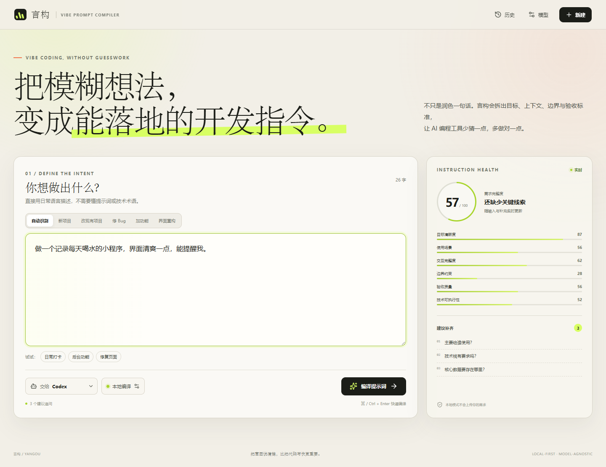
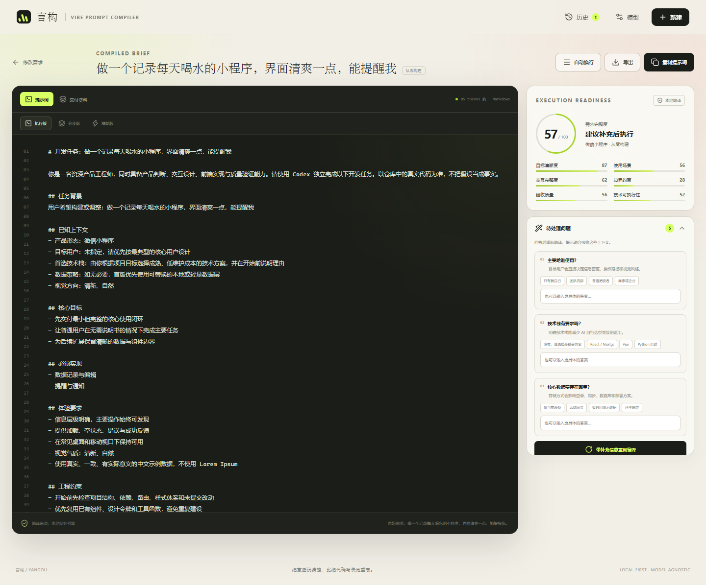
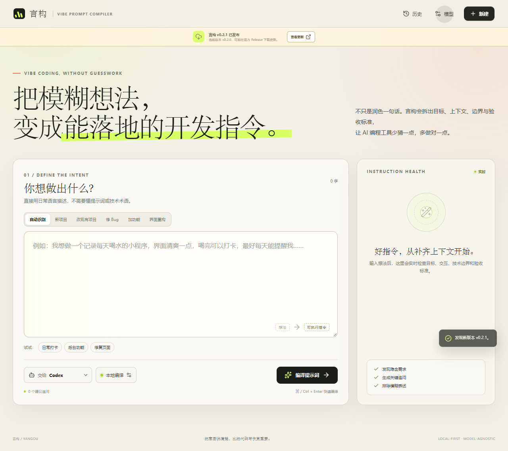
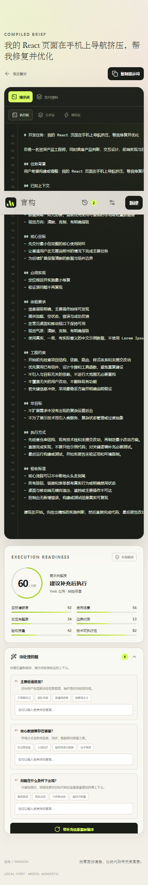

# 言构 · Vibe Prompt Compiler

> 把模糊想法编译成能落地的开发指令。

[](https://github.com/lvhuana2336/vibe-prompt-compiler/actions/workflows/ci.yml)


言构是一款本地优先的 **Vibe Coding 需求编译器**。它不会只把一句话润色得更专业，而是把自然语言想法拆解成目标、上下文、功能范围、工程约束、执行步骤和验收标准，生成 AI 编程工具可以直接执行的开发提示词。

项目同时提供 Web、Windows 桌面版和 Android PWA。没有模型密钥时也能完整使用本地编译器；配置模型后，可以获得更深入的语义理解与追问。



## 解决的问题

普通人使用 AI 编程工具时，真正缺少的通常不是措辞，而是：

- 目标用户和运行平台没有说明；
- “好看一点”无法转化为可验证视觉约束；
- 现有项目上下文、关键文件和技术栈缺失；
- 没有非目标、边界条件和异常状态；
- 没有可以逐项验证的验收标准。

言构会识别这些缺口，最多追问 3 个真正影响交付的问题，再重新编译完整任务。

## 核心能力

| 能力 | 说明 |
| --- | --- |
| 需求诊断 | 从目标、场景、交互、约束、验收、技术六个维度实时评分 |
| 智能追问 | 针对缺失信息生成少量高价值问题，吸收回答后重新编译 |
| 提示词编译 | 输出执行版、分步版、精简版、需求规格和验收清单 |
| 工具适配 | 针对 Codex、Claude Code、Cursor、Lovable / Bolt 调整执行约定 |
| 多模型路由 | 支持 OpenAI、Claude、Gemini、DeepSeek、Kimi、Qwen、GLM 等接口 |
| 本地优先 | 无密钥可用，模型失败时自动保留本地编译结果 |
| 本地历史 | 编译记录、模型配置和历史恢复均保存在当前设备 |
| 桌面交付 | Windows 安装包内置运行时，不要求用户另装 Node.js |
| 更新检查 | Windows 启动后自动检查新版本，也可在模型设置中手动检查 |
| 中转站诊断 | 自动规范化 Base URL，检测密钥、模型列表和兼容协议 |
| Android 准备 | 可安装 PWA、离线应用壳与 Capacitor Android 工程底座 |



## 工作流程


本地编译器始终先运行。即使云端模型超时、限流或返回异常，用户仍然可以获得结构完整、可执行的本地结果。

## 快速开始

环境要求：

- Node.js 22.12 或更高版本
- pnpm 11

```powershell
git clone https://github.com/lvhuana2336/vibe-prompt-compiler.git
cd vibe-prompt-compiler
```

```powershell
pnpm install
pnpm dev
```

打开 `http://127.0.0.1:5173`。

生产模式：

```powershell
pnpm build
pnpm start
```

## Windows 桌面版

运行已构建的前端：

```powershell
pnpm desktop
```

桌面开发模式：

```powershell
pnpm desktop:dev
```

生成 Windows x64 安装程序：

```powershell
pnpm dist:win
```

输出位置：

```text
release/YanGou-Setup-0.2.0.exe
```

桌面版采用 Electron 主进程与本地回环服务：

- 单实例运行；
- 随机本地端口，不暴露到局域网；
- 渲染进程启用沙箱和上下文隔离；
- 不开启 Node.js 集成；
- 阻止外部页面替换应用窗口；
- 关闭窗口时自动释放本地服务。

应用启动约 3.5 秒后会静默检查 GitHub Release，也可以在“模型 → 应用更新”中手动检查。发现新版本时会展示更新提示并打开官方 Release 下载页。



> v0.2.0 不执行未签名静默安装更新。当前安装包未配置商业代码签名证书，首次运行时 Windows SmartScreen 可能显示“未知发布者”。公开发布前建议补充代码签名证书。

## Android 与 PWA

v0.2.0 提供可安装 PWA：

- 支持添加到 Android 主屏幕。
- 公开实例：[lvhuana2336.github.io/vibe-prompt-compiler](https://lvhuana2336.github.io/vibe-prompt-compiler/)。
- 应用壳和本地编译器支持离线使用。
- 包含 Service Worker 自动缓存、安全区适配和移动端布局。
- 同时生成 Capacitor Android 工程，后续可直接扩展原生能力。



同步 Android 工程：

```powershell
pnpm android:sync
```

打开 Android Studio：

```powershell
pnpm android:open
```

当前环境没有 Android SDK，因此 v0.2.0 不提供已签名 APK。原生模型直连、Android Keystore 密钥存储和 APK 发布计划在 v0.2.1 完成。

如需为 Capacitor 构建连接远程模型代理，可设置：

```powershell
$env:VITE_YANGOU_API_BASE_URL="https://your-api.example.com"
```

## 支持的模型接口

| 协议 | 支持入口 |
| --- | --- |
| OpenAI Responses | OpenAI |
| OpenAI-compatible Chat Completions | DeepSeek、Kimi、通义千问、智谱、硅基流动、Ollama、LM Studio、自定义接口 |
| Anthropic Messages | Claude |
| Gemini Generate Content | Google Gemini |
| 本地规则引擎 | 无密钥、完全离线 |

DragonAPI / New API 预设：

```text
Base URL：https://newapi.dragon3api.com/v1
协议：自动兼容、Chat Completions 或 Responses
```

“测试连接”优先请求 `/models`，不会消耗生成额度。站点首页、`/v1` 和完整接口地址会自动规范化。

API Key 默认只在当前会话生效。主动勾选“记住密钥”后才会写入本地应用存储，不建议在公共设备上开启。

也可以使用环境变量：

```powershell
$env:OPENAI_API_KEY="..."
$env:ANTHROPIC_API_KEY="..."
$env:GEMINI_API_KEY="..."
```

其他兼容服务支持：

```text
DEEPSEEK_API_KEY
MOONSHOT_API_KEY
DASHSCOPE_API_KEY
ZHIPU_API_KEY
SILICONFLOW_API_KEY
```

## 隐私与安全

- 本地编译模式不会上传需求内容。
- 使用模型时，请求会发送到用户自行选择的服务商。
- API Key 不会写入项目源码或仓库。
- `.env`、构建产物、安装包和本地测试截图不会进入 Git 历史。
- 安全问题请通过 GitHub 私密漏洞报告功能提交，详见 [SECURITY.md](SECURITY.md)。

## 验证

```powershell
pnpm test
pnpm build
```

涉及界面时，可以先启动服务再运行：

```powershell
pnpm test:visual
```

视觉检查使用本机 Chrome，验证首页、编译结果、模型设置和移动端布局，并检查页面级横向溢出与控制台错误。

## 项目结构

```text
electron/              Electron 主进程与桌面窗口
android/               Capacitor Android 原生工程
shared/                前后端共享的版本与 URL 规范化逻辑
server/                本地服务、模型路由与 API 适配器
src/
  data/providers.js    模型与编程工具预设
  lib/compiler.js      本地需求编译器与提示词生成
  App.jsx              主要产品界面
  styles.css           响应式视觉系统
tests/                 编译器和模型协议测试
scripts/               图标生成与视觉验收
public/                PWA 清单、Service Worker 与图标
.github/               CI、CodeQL、Release 与社区模板
```

## 参与贡献

提交代码前请阅读 [CONTRIBUTING.md](CONTRIBUTING.md)。请不要在 Issue、提交或日志中公开 API Key、私钥或真实用户数据。

## 许可证

[MIT](LICENSE)
